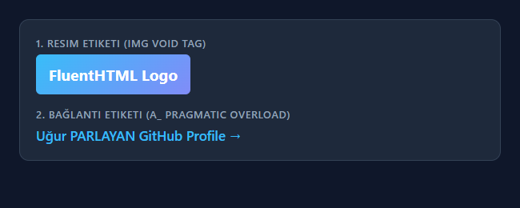
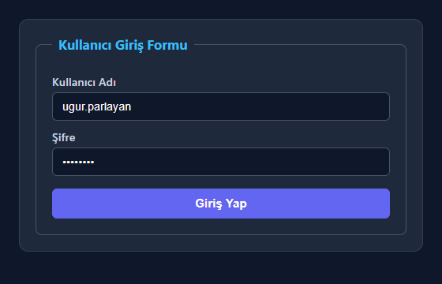
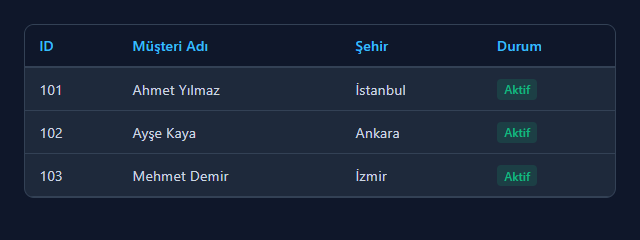
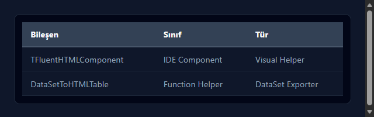
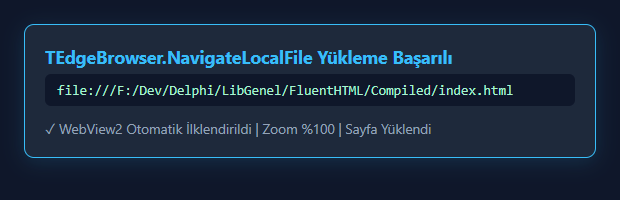
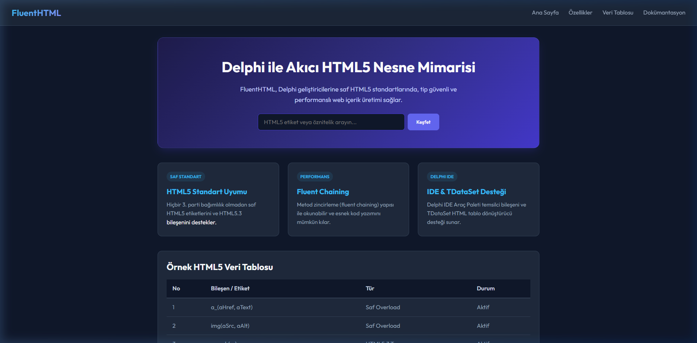

# FluentHTML

> **Delphi için Akıcı, Tip Güvenli ve Performanslı HTML5 Üretim Motoru**  
> **Fluent, Type-Safe, and Performant HTML5 Generation Engine for Delphi**

**Yazar / Author:** Uğur PARLAYAN  
**Lisans / License:** MIT  

---

## 📋 İçindekiler / Table of Contents

- [🇹🇷 Türkçe Dokümantasyon](#-türkçe-dokümantasyon)
  - [Hakkında](#hakkında)
  - [Öne Çıkan Özellikler](#öne-çıkan-özellikler)
  - [Yapılan Son Değişiklikler ve İyileştirmeler](#yapılan-son-değişiklikler-ve-i̇yileştirmeler)
  - [TEdgeBrowser İnce Detayları ve Çözüm Rehberi](#tedgebrowser-i̇nce-detayları-ve-çözüm-rehberi)
  - [Bilinen Sorunlar ve Devam Eden Çalışmalar](#bilinen-sorunlar-ve-devam-eden-çalışmalar)
  - [Örnekler ve Çıktı Ekran Görüntüleri (Basitten Karmaşığa)](#örnekler-ve-çıktı-ekran-görüntüleri-basitten-karmaşığa)
    - [1. Basit Etiket Kullanımı ve Pratik Yardımcılar](#1-basit-etiket-kullanımı-ve-pratik-yardımcılar)
    - [2. İç İçe Ağaç Yapısı ve HTML5 Form Üretimi](#2-i̇ç-içe-ağaç-yapısı-ve-html5-form-üretimi)
    - [3. TDataSet Entegrasyonu (HTML5 Tablo Dönüştürücü)](#3-tdataset-entegrasyonu-html5-tablo-dönüştürücü)
    - [4. IDE Bileşeni Kullanımı (TFluentHTMLComponent)](#4-ide-bileşeni-kullanımı-tfluenthtmlcomponent)
    - [5. TEdgeBrowser Entegrasyonu (FluentHTML.Edge Class Helper)](#5-tedgebrowser-entegrasyonu-fluenthtmledge-class-helper)
    - [6. İleri Seviye: Komple Modern HTML5 Dashboard Sayfası](#6-i̇leri-seviye-komple-modern-html5-dashboard-sayfası)
  - [🎨 Örneklerde Kullanılan CSS Şablonu](#-örneklerde-kullanılan-css-şablonu)
- [🇬🇧 English Documentation](#-english-documentation)
  - [About](#about)
  - [Key Features](#key-features)
  - [Recent Changes & Improvements](#recent-changes--improvements)
  - [TEdgeBrowser Nuances & Troubleshooting Guide](#tedgebrowser-nuances--troubleshooting-guide)
  - [Known Issues & Ongoing Development](#known-issues--ongoing-development)
  - [Examples & Output Screenshots (From Basic to Advanced)](#examples--output-screenshots-from-basic-to-advanced)
    - [1. Basic Tags & Pragmatic Overloaded Helpers](#1-basic-tags--pragmatic-overloaded-helpers)
    - [2. Nested Tree Structure & HTML5 Form Generation](#2-nested-tree-structure--html5-form-generation)
    - [3. TDataSet Integration (HTML5 Table Converter)](#3-tdataset-integration-html5-table-converter)
    - [4. IDE Component Usage (TFluentHTMLComponent)](#4-ide-component-usage-tfluenthtmlcomponent)
    - [5. TEdgeBrowser Integration (FluentHTML.Edge Class Helper)](#5-tedgebrowser-integration-fluenthtmledge-class-helper)
    - [6. Advanced: Complete Modern HTML5 Dashboard Page](#6-advanced-complete-modern-html5-dashboard-page)
  - [🎨 Sample CSS Template Used in Examples](#-sample-css-template-used-in-examples)

---

# 🇹🇷 Türkçe Dokümantasyon

## Hakkında
**FluentHTML**, Delphi geliştiricilerinin dize birleştirme (string concatenation) karmaşasına girmeden, nesne yönelimli ve metod zincirleme (*fluent chaining*) yöntemiyle saf HTML5 içerikleri üretmesini sağlayan hafif, tip güvenli ve yüksek performanslı bir kütüphanedir.

*Not: Kütüphane sadece HTML5 etiket üretimi (generation) içindir; HTML parse işlevi içermez.*

---

## Öne Çıkan Özellikler

- **Saf HTML5 ve HTML5.3 Desteği:** `<search>`, `<header>`, `<footer>`, `<main>`, `<article>`, `<section>` dahil tüm modern etiket desteği.
- **Kapanış Etiketsiz (Void Tags) Doğru Yapı:** ``, `<br>`, `<hr>`, `<input>`, `<meta>`, `<link>` gibi etiketleri otomatik olarak kapanış etiketsiz (`</img>` olmadan) doğru standartta üretir.
- **Metod Zincirleme (Fluent Chaining):** `div_('İçerik').class_('card').id('my-id')` şeklinde okunabilir kod yazımı.
- **Pratik Overload Yardımcıları:** `a_('https://site.com', 'Metin')`, `img('/logo.png', 'Alt Metin')`, `link('/style.css')`, `script('').src('/app.js')` gibi tek satırlık pratik metotlar.
- **Öznitelik Doğrulama (Attribute Validation):** Etiketlere uygunsuz öznitelik eklendiğinde (örn. `<p>` etiketine `action` eklenmeye çalışıldığında) derleme veya çalışma zamanında istisna fırlatan güvenli yapı.
- **TDataSet Entegrasyonu:** Delphi `TDataSet` (FDQuery, ClientDataSet vb.) verilerini otomatik HTML5 veri tablosuna dönüştürme.
- **IDE Araç Paleti Bileşeni:** Delphi IDE içerisinden sürükle-bırak ile kullanılabilen `TFluentHTMLComponent` bileşeni.
- **TEdgeBrowser Class Helper:** Delphi `TEdgeBrowser` bileşeni için yerel HTML dosya yükleme (`NavigateLocalFile`), yakınlaştırma (`ZoomIn`/`ZoomOut`), yazdırma ve PDF dışa aktarma (`PrintToPdfAsync`) kolaylıkları.

---

## Yapılan Son Değişiklikler ve İyileştirmeler

- 🆕 **HTML5.3 `<search>` Etiketi Desteği:** Modern web standartlarına uygun `<search>` semantik etiketi eklendi.
- ⚡ **`FluentHTML.Edge` NavigateLocalFile Düzeltmesi:** Asenkron WebView2 oluşturma sürecinde yerel dosya yolunun kaybolması engellendi; göreli ve tam dosya yolları `file:///` formatına güvenli şekilde dönüştürüldü.
- 🛡️ **EdgeBrowser Sürüm & Yetki Yönetimi:** `TargetCompatibleBrowserVersion` bağımlılığı temizlendi, `UserDataFolder` dinamik `AppData\Local` dizinine yönlendirilerek `0x80004005` (E_FAIL) WebView2 başlatma hataları giderildi.
- 📁 **Standart Proje Çıktı Mimarisi:** Derlenmiş binary çıktılar `Compiled\Exe\` ve derlenmiş ara üniteler `Compiled\Dcu\` klasörlerine ayrıştırıldı.
- 🧪 **Otomatik Konsol Test Paketi:** Void tag, ağaç yapısı, attribute validation, dataset entegrasyonu ve Edge helper işlevlerini kapsayan 8 modüllü otomatik test paketi (`test\TestFluentHTML.dpr`) eklendi.

---

## TEdgeBrowser İnce Detayları ve Çözüm Rehberi

Demo uygulamasının geliştirilmesi sürecinde karşılaşılan `TEdgeBrowser` / WebView2 sorunları ve çözümleri aşağıda derlenmiştir:

1. **Sabit Versiyon Kilitlenmesi (`TargetCompatibleBrowserVersion`):**
   - *Sorun:* DFM dosyasında `TargetCompatibleBrowserVersion = '117.0.2045.28'` gibi sabit bir sürüm tanımlandığında, sistemdeki güncel Edge runtime (örn: 120+, 130+) ile uyuşmayarak `CreateWebView` çağrısı başarısız olmaktadır.
   - *Çözüm:* DFM içerisinden bu nitelik silinmeli veya pascal tarafında boş string bırakılmalıdır.

2. **`UserDataFolder` İzin ve Çevre Değişkeni Sorunu (`0x80004005` E_FAIL):**
   - *Sorun:* DFM içindeki `%LOCALAPPDATA%` environment değişkenleri VCL tarafından otomatik genişletilmez. Ayrıca `UserDataFolder` boş bırakıldığında EXE dizinine yazmaya çalışıp yetki hatası verebilir.
   - *Çözüm:* `FormCreate` anında `EdgeWB.UserDataFolder := TPath.Combine(TPath.GetCachePath, 'FluentHTML_WebView2');` ile izinleri tam `AppData\Local` klasörü atanmalı ve `ForceDirectories` çağrılmalıdır.

3. **`WebView2Loader.dll` Bağımlılığı ve Konumu:**
   - *Sorun:* Çalıştırılabilir EXE dosyasının yanında `WebView2Loader.dll` kütüphanesi bulunmadığında WebView2 `0x80004005` hatası ile kilitlenir.
   - *Çözüm:* `WebView2Loader.dll` kütüphanesi EXE çıktı dizinine kopyalanmalı, uygulama açılışında DLL varlığı otomatik kontrol edilmelidir.

4. **Asenkron `CreateWebView` ve Yönlendirme Adres Kaybı (`NavigateLocalFile`):**
   - *Sorun:* `WebViewCreated` `False` durumundayken `CreateWebView` elle çağrılıp adres saklanmazsa ilk navigasyon gerçekleşmez.
   - *Çözüm:* `Self.Navigate(LUrl)` çağrılmalıdır. VCL `TCustomEdgeBrowser.Navigate` metodu, WebView2 henüz oluşmamışsa adresi `FInitialURI` alanına kaydeder ve WebView2 ilklendirilmesi tamamlandığında otomatik olarak o adrese yönlenir.

5. **Çift Yönlendirme ve `OPERATION_CANCELED` (WebErrorStatus: 9):**
   - *Sorun:* WebView2 henüz hazırlanırken üst üste navigasyon isteği gönderilmesi ilk yönlendirmeyi iptal eder (`Operation Canceled`).
   - *Çözüm:* `UpdateDemoDashboard` metodunda `if EdgeWB.WebViewCreated then NavigateLocalFile(FCikisYolu) else CreateWebView;` kontrolü ile akış optimize edilmelidir.

---

## Bilinen Sorunlar ve Devam Eden Çalışmalar

> ℹ️ *Aşağıdaki konularda aktif geliştirme, test ve optimizasyon çalışmaları devam etmektedir:*

- ⏳ **Asenkron WebView2 İlk Yükleme Gecikmesi:** Uygulama açılışında WebView2 Runtime motorunun ilklendirilmesi esnasında milisaniyelik bir yükleme aralığı oluşmaktadır. Bu süreç için dahili bir yükleme göstergesi (loading indicator) mekanizması üzerinde çalışılmaktadır.
- 🎨 **Harici CSS/JS Varlıkları için Gömülü (Inline) Dönüştürücü:** Yerel HTML çıktılarında harici CSS ve JS dosyalarının otomatik `style(...)` ve `script(...)` gömülü bloklarına dönüştürülmesine ilişkin yardımcı yardımcı birimler geliştirilmektedir.
- 📱 **Çapraz Platform (FireMonkey / FMX) Genişletmesi:** Şu anda VCL tabanlı `TEdgeBrowser` için sunulan class helper yapısının FireMonkey (`FMX.WebBrowser`) platform bileşenlerine uyarlanması üzerine mimari çalışmalar sürdürülmektedir.
- 📊 **Karmaşık Hücre Birleştirmeli TDataSet Tablo Çıktısı:** `DataSetToHTMLTable` metodunun `rowspan` ve `colspan` gibi gelişmiş HTML5 tablo özniteliklerini dinamik desteklemesi için geliştirme çalışmaları devam etmektedir.

---

## Örnekler ve Çıktı Ekran Görüntüleri (Basitten Karmaşığa)

### 1. Basit Etiket Kullanımı ve Pratik Yardımcılar
```pascal
uses FluentHTML;

var
  LTag: THTMLTag;
begin
  // Resim Etiketi (Void tag: </img> içermez)
  LTag := img('/images/logo.png', 'Şirket Logosu').id('main_logo').class_('responsive-img');
  Writeln(LTag.ToString);

  // Bağlantı Etiketi (Pratik overload)
  LTag := a_('https://github.com/uparlayan', 'Uğur PARLAYAN GitHub Profile').target('_blank');
  Writeln(LTag.ToString);
end;
```
#### 🖼️ Örnek 1 Çıktı Ekran Görüntüsü


---

### 2. İç İçe Ağaç Yapısı ve HTML5 Form Üretimi
```pascal
uses FluentHTML;

var
  LForm: THTMLTag;
begin
  LForm := form([
             fieldset('Kullanıcı Giriş Formu')
           , label_('Kullanıcı Adı', [
               br
             , input.type_('text').name('username').placeholder('Kullanıcı adınızı giriniz').required
             ])
           , br
           , label_('Şifre', [
               br
             , input.type_('password').name('password').placeholder('********').required
             ])
           , br
           , button('Giriş Yap').type_('submit').class_('btn btn-primary')
           ]).action('/login').method('post');

  Writeln(LForm.ToString);
  FreeAndNil(LForm);
end;
```
#### 🖼️ Örnek 2 Çıktı Ekran Görüntüsü


---

### 3. TDataSet Entegrasyonu (HTML5 Tablo Dönüştürücü)
```pascal
uses FluentHTML, FluentHTML.DataSet, Data.DB;

procedure RenderDataSetTable(ADataSet: TDataSet);
var
  LTableTag: THTMLTag;
begin
  // Delphi TDataSet verisini otomatik HTML5 <table> etiketine dönüştürür
  LTableTag := DataSetToHTMLTable(ADataSet);
  if Assigned(LTableTag) then
  begin
    LTableTag.class_('table table-striped table-hover');
    Writeln(LTableTag.ToString);
    FreeAndNil(LTableTag);
  end;
end;
```
#### 🖼️ Örnek 3 Çıktı Ekran Görüntüsü


---

### 4. IDE Bileşeni Kullanımı (TFluentHTMLComponent)
```pascal
uses FluentHTML.Component;

procedure GenerateTableFromComponent(AComp: TFluentHTMLComponent);
var
  LHtmlText: string;
begin
  AComp.TableClass := 'table table-dark';
  AComp.HeaderClass := 'thead-light';
  
  // TDataSet atanmış bileşenden HTML tablo string çıktısı alma
  LHtmlText := AComp.GenerateHTMLTable;
  Writeln(LHtmlText);
end;
```
#### 🖼️ Örnek 4 Çıktı Ekran Görüntüsü


---

### 5. TEdgeBrowser Entegrasyonu (FluentHTML.Edge Class Helper)
```pascal
uses Vcl.Edge, FluentHTML.Edge;

procedure TForm1.LoadLocalHtmlFile;
var
  LPath: string;
begin
  LPath := ExtractFilePath(ParamStr(0)) + 'index.html';

  // Windows dosya yolunu (C:\...) file:/// URI formatına çevirip EdgeBrowser'a yükler.
  // WebView2 henüz hazır değilse otomatik olarak asenkron başlatmayı yönetir.
  EdgeWB.NavigateLocalFile(LPath);
end;
```
#### 🖼️ Örnek 5 Çıktı Ekran Görüntüsü


---

### 6. İleri Seviye: Komple Modern HTML5 Dashboard Sayfası
```pascal
uses FluentHTML;

function CreateModernDashboard: string;
var
  LPage: THTMLTag;
begin
  LPage := html([
             head([
               meta.charset('UTF-8')
             , meta.name('viewport').content('width=device-width, initial-scale=1.0')
             , title('FluentHTML - Modern Dashboard')
             , style('body { background: #0f172a; color: #fff; font-family: sans-serif; } .hero { padding: 2rem; background: #1e293b; border-radius: 8px; }')
             ])
           , body([
               header([
                 div_('FluentHTML Engine').class_('logo')
               , nav([ a_('#', 'Ana Sayfa'), a_('#docs', 'Dokümantasyon') ])
               ])
             , main_([
                 section([
                   h1('Delphi ile Akıcı HTML5 Üretimi')
                 , p_('Tip güvenli ve yüksek performanslı web bileşen üretimi.')
                 , search([
                     input.type_('search').placeholder('Etiket arayın...').id('search_input')
                   , button('Ara').type_('button')
                   ])
                 ]).class_('hero')
               ])
             , footer([ p_('© 2026 Uğur PARLAYAN | FluentHTML Engine') ])
             ])
           ]).lang('tr');

  Result := '<!DOCTYPE html>' + #13#10 + LPage.ToString;
  FreeAndNil(LPage);
end;
```
#### 🖼️ Örnek 6 Çıktı Ekran Görüntüsü (Komple Modern Dashboard)


---

## 🎨 Örneklerde Kullanılan CSS Şablonu

> 💡 **Önemli Bilgilendirme:** **FluentHTML** kütüphanesi saf HTML5 etiket yapıları ve semantik ağaçlar üretir. Yukarıdaki örnek çıktı görsellerinde yer alan modern karanlık tema (dark mode), renkler ve düzen tasarımları aşağıdaki CSS şablonu ile sağlanmıştır. Ürettiğiniz HTML içeriklerine bu CSS kodunu `style(...)` etiketi veya harici `.css` dosyası olarak ekleyerek aynı ekran görüntülerini elde edebilirsiniz:

```css
/* FluentHTML - Örneklerde Kullanılan Modern Dark Mode CSS Şablonu */
* { box-sizing: border-box; margin: 0; padding: 0; font-family: "Segoe UI", -apple-system, sans-serif; }
body { background-color: #0f172a; color: #f8fafc; line-height: 1.6; padding: 1.5rem; }

/* Konteynırlar ve Kartlar */
.container { background: #1e293b; border: 1px solid #334155; border-radius: 12px; padding: 1.25rem; max-width: 650px; }
.card { background: #1e293b; border: 1px solid #334155; border-radius: 12px; padding: 1.5rem; transition: transform 0.2s, border-color 0.2s; }
.card:hover { transform: translateY(-4px); border-color: #6366f1; }
.card h3 { color: #38bdf8; margin-bottom: 0.5rem; font-size: 1.25rem; }
.card p { color: #94a3b8; font-size: 0.95rem; }

/* Tipografi ve Bağlantılar */
h1 { color: #ffffff; font-size: 2rem; margin-bottom: 0.75rem; }
a { color: #38bdf8; text-decoration: none; font-weight: 600; }
a:hover { text-decoration: underline; }
.label { color: #94a3b8; font-size: 0.8rem; margin-bottom: 0.4rem; text-transform: uppercase; letter-spacing: 0.05em; font-weight: 600; }

/* Formlar ve Girdiler */
form { background: #1e293b; border: 1px solid #334155; border-radius: 12px; padding: 1.25rem; max-width: 520px; }
fieldset { border: 1px solid #475569; border-radius: 8px; padding: 1rem 1.25rem 1.25rem 1.25rem; }
legend { color: #38bdf8; font-weight: 700; padding: 0 0.5rem; font-size: 1.05rem; }
label { color: #cbd5e1; font-weight: 500; display: block; margin-top: 0.6rem; font-size: 0.9rem; }
input[type="text"], input[type="password"], input[type="search"] { width: 100%; padding: 0.6rem 0.8rem; margin-top: 0.3rem; border-radius: 6px; border: 1px solid #475569; background: #0f172a; color: #fff; font-size: 0.9rem; }
input:focus { border-color: #6366f1; outline: none; }
button { margin-top: 1rem; padding: 0.65rem 1.25rem; border-radius: 6px; border: none; background: #6366f1; color: #fff; font-weight: 600; cursor: pointer; transition: background 0.2s; }
button:hover { background: #4f46e5; }

/* Veri Tabloları */
.table-container { max-width: 650px; background: #1e293b; border-radius: 10px; border: 1px solid #334155; overflow: hidden; }
table { width: 100%; border-collapse: collapse; text-align: left; font-size: 0.9rem; }
th, thead.thead-light th { background: #0f172a; color: #38bdf8; padding: 0.65rem 0.9rem; font-weight: 600; border-bottom: 2px solid #334155; }
td { padding: 0.65rem 0.9rem; border-bottom: 1px solid #334155; color: #cbd5e1; }
tr:hover td { background: rgba(51, 65, 85, 0.5); }
table.table-dark td { background: #0f172a; color: #94a3b8; }
.badge { display: inline-block; padding: 0.15rem 0.45rem; border-radius: 4px; background: rgba(16, 185, 129, 0.15); color: #10b981; font-size: 0.75rem; font-weight: 600; }
```

---
---

# 🇬🇧 English Documentation

## About
**FluentHTML** is a lightweight, type-safe, and high-performance Delphi library that enables developers to build clean HTML5 markup using an object-oriented and *fluent chaining* API without resorting to messy string concatenations.

*Note: This library is strictly designed for HTML5 markup generation; it does NOT parse HTML.*

---

## Key Features

- **Pure HTML5 & HTML5.3 Compliance:** Full support for modern semantic tags including `<search>`, `<header>`, `<footer>`, `<main>`, `<article>`, and `<section>`.
- **Proper Void Tag Handling:** Generates void tags like ``, `<br>`, `<hr>`, `<input>`, `<meta>`, and `<link>` without illegal closing tags (e.g. no `</img>`).
- **Fluent Chaining API:** Clean and readable syntax such as `div_('Content').class_('card').id('my-id')`.
- **Pragmatic Overloaded Helpers:** Convenient single-line helper functions like `a_('https://site.com', 'Text')`, `img('/logo.png', 'Alt')`, `link('/style.css')`, and `script('').src('/app.js')`.
- **Attribute Validation:** Strict rules preventing invalid attribute usage (e.g., attempting to attach an `action` attribute to a `<p>` tag throws an exception).
- **TDataSet Integration:** Automatically converts Delphi `TDataSet` records (FDQuery, ClientDataSet, etc.) into structured HTML5 data tables.
- **IDE Component Palette Support:** Includes `TFluentHTMLComponent` for visual drag-and-drop integration in Delphi RAD Studio.
- **TEdgeBrowser Class Helper:** Provides `NavigateLocalFile`, `ZoomIn`/`ZoomOut`, `Print`, and `PrintToPdfAsync` utilities for VCL `TEdgeBrowser`.

---

## Recent Changes & Improvements

- 🆕 **HTML5.3 `<search>` Tag Support:** Added modern semantic `<search>` element.
- ⚡ **`FluentHTML.Edge` NavigateLocalFile Fix:** Resolved URL loss during async WebView2 creation; safe URL resolution for relative and absolute paths (`file:///`).
- 🛡️ **EdgeBrowser Runtime & Permission Fix:** Removed rigid `TargetCompatibleBrowserVersion` locks and dynamically redirected `UserDataFolder` to `AppData\Local` to resolve `0x80004005` (E_FAIL) initialization errors.
- 📁 **Standard Output Directory Architecture:** Organized output binaries into `Compiled\Exe\` and compiled unit binaries into `Compiled\Dcu\`.
- 🧪 **Automated Console Test Suite:** Added an 8-module automated test suite (`test\TestFluentHTML.dpr`) validating void tags, tree structures, attribute validation, dataset conversion, and Edge helper URL formatting.

---

## TEdgeBrowser Nuances & Troubleshooting Guide

Summary of key `TEdgeBrowser` / WebView2 nuances and technical solutions discovered during demo application development:

1. **Hardcoded Version Locks (`TargetCompatibleBrowserVersion`):**
   - *Issue:* Defining a hardcoded version string like `TargetCompatibleBrowserVersion = '117.0.2045.28'` in the DFM causes `CreateWebView` to fail when the installed Edge runtime is newer (e.g., 120+, 130+).
   - *Solution:* Remove this property from the DFM or leave it as an empty string in code.

2. **`UserDataFolder` Permissions & Environment Variables (`0x80004005` E_FAIL):**
   - *Issue:* `%LOCALAPPDATA%` strings are not expanded automatically by VCL. Leaving `UserDataFolder` empty causes WebView2 to attempt writing to the application directory, resulting in permission failures (`0x80004005`).
   - *Solution:* Set `EdgeWB.UserDataFolder := TPath.Combine(TPath.GetCachePath, 'FluentHTML_WebView2');` in `FormCreate` to direct it to a fully accessible `AppData\Local` directory and invoke `ForceDirectories`.

3. **`WebView2Loader.dll` Dependency & Path Location:**
   - *Issue:* Missing `WebView2Loader.dll` in the executable folder results in `0x80004005` (E_FAIL) errors or silent initialization failures.
   - *Solution:* Deploy `WebView2Loader.dll` alongside the executable and verify its presence automatically at application startup.

4. **Async `CreateWebView` & URL Loss (`NavigateLocalFile`):**
   - *Issue:* Calling `CreateWebView` manually when `WebViewCreated` is `False` drops the target URL if not preserved.
   - *Solution:* Invoke `Self.Navigate(LUrl)`. VCL's `TCustomEdgeBrowser.Navigate` stores the URL in `FInitialURI` when `WebViewCreated` is `False` and navigates automatically once initialization completes.

5. **Double Navigation & `OPERATION_CANCELED` (WebErrorStatus: 9):**
   - *Issue:* Triggering multiple navigation requests while async WebView2 creation is pending cancels the initial request (`Operation Canceled`).
   - *Solution:* Optimize the flow in `UpdateDemoDashboard` with `if EdgeWB.WebViewCreated then NavigateLocalFile(FCikisYolu) else CreateWebView;`.

---

## Known Issues & Ongoing Development

> ℹ️ *Active development, testing, and optimization are currently underway for the following areas:*

- ⏳ **Async WebView2 Initial Load Delay:** A brief milliseconds delay occurs during WebView2 Runtime initialization on cold startup. An internal loading indicator mechanism is under active development.
- 🎨 **Inline Converter for External CSS/JS Assets:** Helper utilities are being developed to inline external CSS stylesheets and JS files directly into `<style>` and `<script>` blocks for standalone HTML generation.
- 📱 **Cross-Platform (FireMonkey / FMX) Expansion:** Architectural research is ongoing to expand `FluentHTML.Edge` class helper features to FireMonkey (`FMX.WebBrowser`) platform components.
- 📊 **Complex Cell Merging in TDataSet Exports:** Active work is in progress to enhance `DataSetToHTMLTable` with dynamic `rowspan` and `colspan` attribute support for complex database queries.

---

## Examples & Output Screenshots (From Basic to Advanced)

### 1. Basic Tags & Pragmatic Overloaded Helpers
```pascal
uses FluentHTML;

var
  LTag: THTMLTag;
begin
  // Image Tag (Void tag: no </img> closing tag)
  LTag := img('/images/logo.png', 'Company Logo').id('main_logo').class_('responsive-img');
  Writeln(LTag.ToString);

  // Hyperlink Tag (Pragmatic overload)
  LTag := a_('https://github.com/uparlayan', 'Uğur PARLAYAN GitHub Profile').target('_blank');
  Writeln(LTag.ToString);
end;
```
#### 🖼️ Example 1 Output Screenshot


---

### 2. Nested Tree Structure & HTML5 Form Generation
```pascal
uses FluentHTML;

var
  LForm: THTMLTag;
begin
  LForm := form([
             fieldset('User Login Form')
           , label_('Username', [
               br
             , input.type_('text').name('username').placeholder('Enter username').required
             ])
           , br
           , label_('Password', [
               br
             , input.type_('password').name('password').placeholder('********').required
             ])
           , br
           , button('Sign In').type_('submit').class_('btn btn-primary')
           ]).action('/login').method('post');

  Writeln(LForm.ToString);
  FreeAndNil(LForm);
end;
```
#### 🖼️ Example 2 Output Screenshot


---

### 3. TDataSet Integration (HTML5 Table Converter)
```pascal
uses FluentHTML, FluentHTML.DataSet, Data.DB;

procedure RenderDataSetTable(ADataSet: TDataSet);
var
  LTableTag: THTMLTag;
begin
  // Converts Delphi TDataSet into an HTML5 <table> element automatically
  LTableTag := DataSetToHTMLTable(ADataSet);
  if Assigned(LTableTag) then
  begin
    LTableTag.class_('table table-striped table-hover');
    Writeln(LTableTag.ToString);
    FreeAndNil(LTableTag);
  end;
end;
```
#### 🖼️ Example 3 Output Screenshot


---

### 4. IDE Component Usage (TFluentHTMLComponent)
```pascal
uses FluentHTML.Component;

procedure GenerateTableFromComponent(AComp: TFluentHTMLComponent);
var
  LHtmlText: string;
begin
  AComp.TableClass := 'table table-dark';
  AComp.HeaderClass := 'thead-light';
  
  // Renders HTML table string from the assigned TDataSet component
  LHtmlText := AComp.GenerateHTMLTable;
  Writeln(LHtmlText);
end;
```
#### 🖼️ Example 4 Output Screenshot


---

### 5. TEdgeBrowser Integration (FluentHTML.Edge Class Helper)
```pascal
uses Vcl.Edge, FluentHTML.Edge;

procedure TForm1.LoadLocalHtmlFile;
var
  LPath: string;
begin
  LPath := ExtractFilePath(ParamStr(0)) + 'index.html';

  // Converts Windows path (C:\...) to file:/// URI format and loads it into EdgeBrowser.
  // Manages async WebView2 initialization automatically if not ready.
  EdgeWB.NavigateLocalFile(LPath);
end;
```
#### 🖼️ Example 5 Output Screenshot


---

### 6. Advanced: Complete Modern HTML5 Dashboard Page
```pascal
uses FluentHTML;

function CreateModernDashboard: string;
var
  LPage: THTMLTag;
begin
  LPage := html([
             head([
               meta.charset('UTF-8')
             , meta.name('viewport').content('width=device-width, initial-scale=1.0')
             , title('FluentHTML - Modern Dashboard')
             , style('body { background: #0f172a; color: #fff; font-family: sans-serif; } .hero { padding: 2rem; background: #1e293b; border-radius: 8px; }')
             ])
           , body([
               header([
                 div_('FluentHTML Engine').class_('logo')
               , nav([ a_('#', 'Home'), a_('#docs', 'Documentation') ])
               ])
             , main_([
                 section([
                   h1('Fluent HTML5 Generation in Delphi')
                 , p_('Type-safe and performant web component generation.')
                 , search([
                     input.type_('search').placeholder('Search tags...').id('search_input')
                   , button('Search').type_('button')
                   ])
                 ]).class_('hero')
               ])
             , footer([ p_('© 2026 Uğur PARLAYAN | FluentHTML Engine') ])
             ])
           ]).lang('en');

  Result := '<!DOCTYPE html>' + #13#10 + LPage.ToString;
  FreeAndNil(LPage);
end;
```
#### 🖼️ Example 6 Output Screenshot (Complete Modern Dashboard)


---

## 🎨 Sample CSS Template Used in Examples

> 💡 **Important Notice:** **FluentHTML** generates pure HTML5 structures and semantic DOM trees. The dark mode theme, colors, and layout in the example screenshots above are styled using the CSS template below. You can include this CSS block via `style(...)` or by linking an external `.css` file to get the exact same visual output:

```css
/* FluentHTML - Sample Modern Dark Mode CSS Template */
* { box-sizing: border-box; margin: 0; padding: 0; font-family: "Segoe UI", -apple-system, sans-serif; }
body { background-color: #0f172a; color: #f8fafc; line-height: 1.6; padding: 1.5rem; }

/* Containers & Cards */
.container { background: #1e293b; border: 1px solid #334155; border-radius: 12px; padding: 1.25rem; max-width: 650px; }
.card { background: #1e293b; border: 1px solid #334155; border-radius: 12px; padding: 1.5rem; transition: transform 0.2s, border-color 0.2s; }
.card:hover { transform: translateY(-4px); border-color: #6366f1; }
.card h3 { color: #38bdf8; margin-bottom: 0.5rem; font-size: 1.25rem; }
.card p { color: #94a3b8; font-size: 0.95rem; }

/* Typography & Links */
h1 { color: #ffffff; font-size: 2rem; margin-bottom: 0.75rem; }
a { color: #38bdf8; text-decoration: none; font-weight: 600; }
a:hover { text-decoration: underline; }
.label { color: #94a3b8; font-size: 0.8rem; margin-bottom: 0.4rem; text-transform: uppercase; letter-spacing: 0.05em; font-weight: 600; }

/* Forms & Inputs */
form { background: #1e293b; border: 1px solid #334155; border-radius: 12px; padding: 1.25rem; max-width: 520px; }
fieldset { border: 1px solid #475569; border-radius: 8px; padding: 1rem 1.25rem 1.25rem 1.25rem; }
legend { color: #38bdf8; font-weight: 700; padding: 0 0.5rem; font-size: 1.05rem; }
label { color: #cbd5e1; font-weight: 500; display: block; margin-top: 0.6rem; font-size: 0.9rem; }
input[type="text"], input[type="password"], input[type="search"] { width: 100%; padding: 0.6rem 0.8rem; margin-top: 0.3rem; border-radius: 6px; border: 1px solid #475569; background: #0f172a; color: #fff; font-size: 0.9rem; }
input:focus { border-color: #6366f1; outline: none; }
button { margin-top: 1rem; padding: 0.65rem 1.25rem; border-radius: 6px; border: none; background: #6366f1; color: #fff; font-weight: 600; cursor: pointer; transition: background 0.2s; }
button:hover { background: #4f46e5; }

/* Data Tables */
.table-container { max-width: 650px; background: #1e293b; border-radius: 10px; border: 1px solid #334155; overflow: hidden; }
table { width: 100%; border-collapse: collapse; text-align: left; font-size: 0.9rem; }
th, thead.thead-light th { background: #0f172a; color: #38bdf8; padding: 0.65rem 0.9rem; font-weight: 600; border-bottom: 2px solid #334155; }
td { padding: 0.65rem 0.9rem; border-bottom: 1px solid #334155; color: #cbd5e1; }
tr:hover td { background: rgba(51, 65, 85, 0.5); }
table.table-dark td { background: #0f172a; color: #94a3b8; }
.badge { display: inline-block; padding: 0.15rem 0.45rem; border-radius: 4px; background: rgba(16, 185, 129, 0.15); color: #10b981; font-size: 0.75rem; font-weight: 600; }
```
